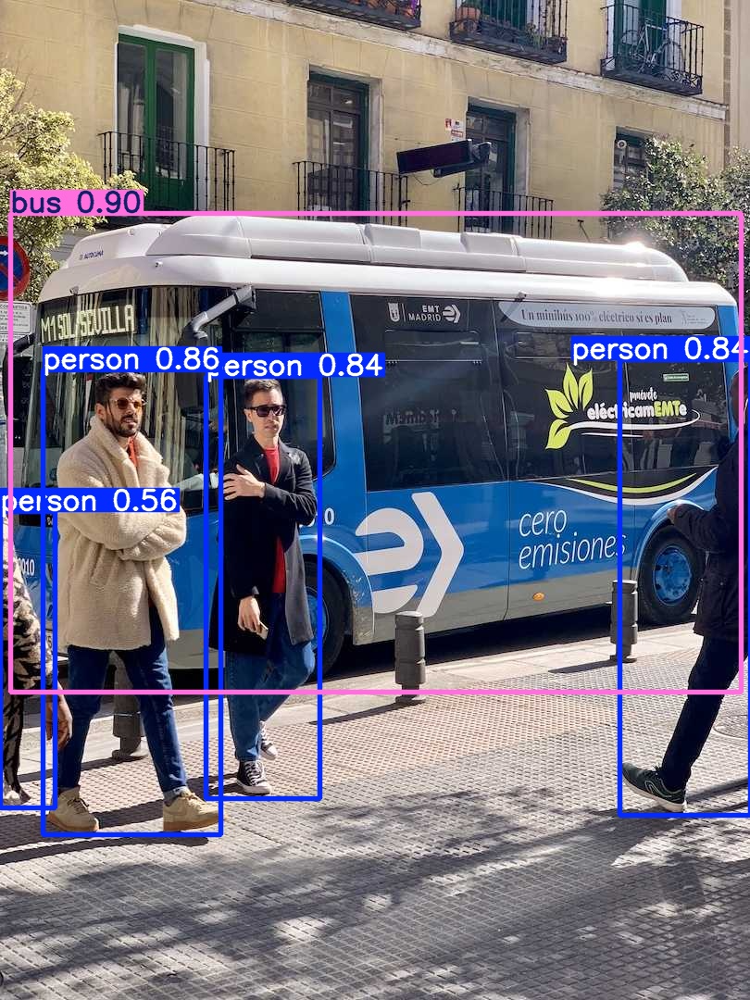
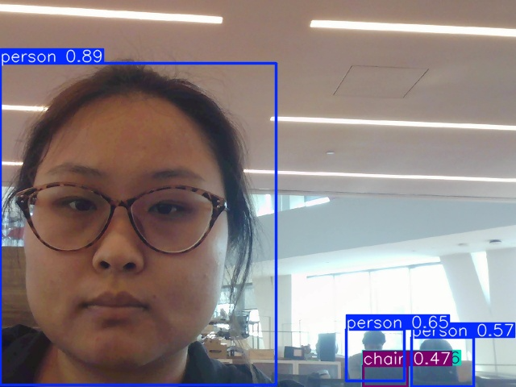
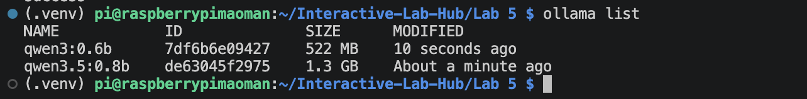
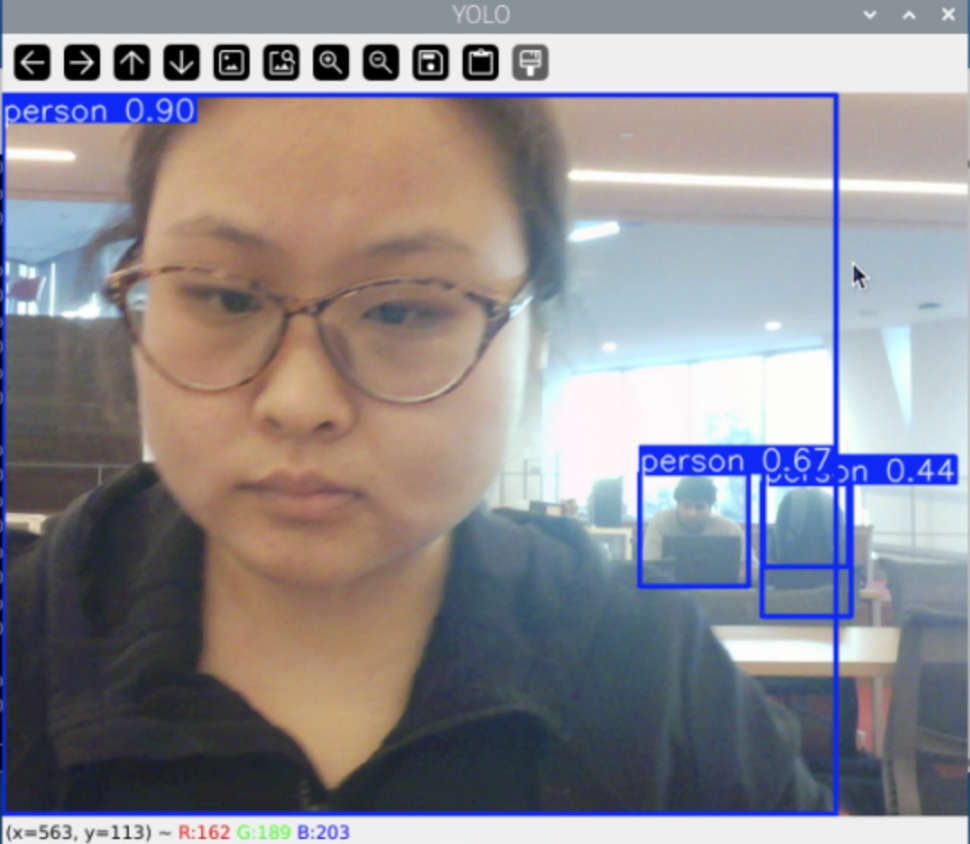
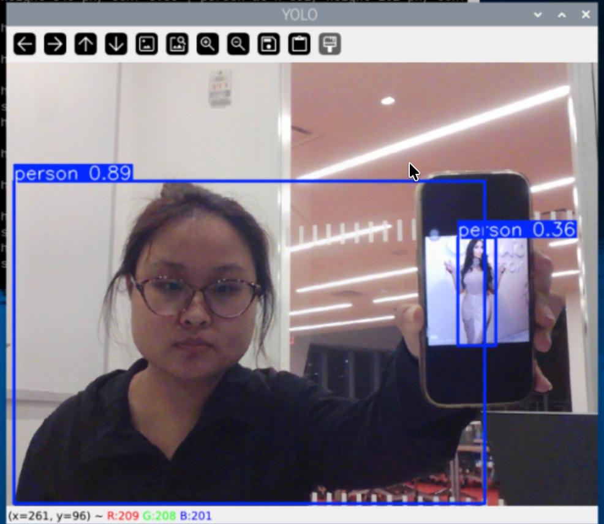
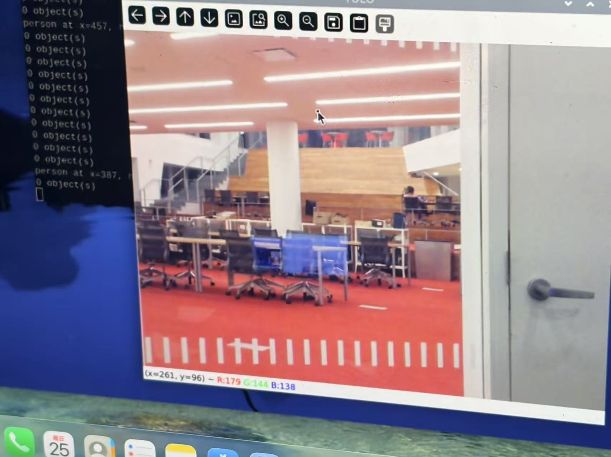

# Observant Systems: Overnight Sensation

**Members:** Wenqing Pan(wp273, Github: WenqingPan-Lucy ); Mandy Mao(mm3599, Github:manrongm)


<details>
	<summary><strong>Instructions for Students (Click to Expand)</strong></summary>
  
	**Submission Cleanup Reminder:**
	- This README.md contains extra instructional text for guidance.
	- Before submitting, remove all instructional text and example prompts from this file.
	- You may delete these sections or use the toggle/hide feature in VS Code to collapse them for a cleaner look.
	- Your final submission should be neat, focused on your own work, and easy to read for grading.
  
	This helps ensure your README.md is clear, professional, and uniquely yours!
</details>


---

# Part 1

## Part A. 

We successfully installed YOLO26 and exported the nano model to NCNN format for running on the Raspberry Pi. We first tested object detection using the sample bus image.



We then tested YOLO object detection on another image to observe how the model identifies objects in different scenes.




\*\*\***Include a screenshot of `ollama list` showing your models.**\*\*\*

We installed Ollama and downloaded the two Qwen models required for this lab:

- `qwen3.5:0.8b`
- `qwen3:0.6b`

The screenshot below shows the installed models using the `ollama list` command.




## Part B. 


\*\*\***Include a short video or screenshots of your experiments with the person detection. Write down three situations where it did not see you, or saw a person who was not there, and what you think the cause was.**\*\*\*


I tested YOLO with my webcam using different commands and confidence thresholds. I also changed my position, showed different objects to the camera, and tested how the model performed under partial visibility, different distances, and low-light conditions.

### 1. Default Detection

**Command:**

python yolo_person.py


**Actual Result:**

YOLO successfully detected people in real time and drew bounding boxes around them. The confidence scores changed as I moved or changed my position.

Interestingly, when I showed only one of my arms to the camera while keeping the rest of my body outside the frame, YOLO still detected it as a person.

I also showed a photo of a person on my phone, and YOLO identified the person in the photo.

**Explanation:**

YOLO does not always need to see a complete human body to detect a person. It can sometimes recognize a person based on limited visual features, such as a visible arm. This can be useful when someone is partially blocked or outside the camera's view.

However, the model cannot reliably distinguish a real person from a person displayed on a screen.

### 2. Lower Confidence Threshold (--conf 0.2)

**Video:** [Low Confidence Detection](https://drive.google.com/file/d/1ZU4gx6UtopPDo3UMGfKiFwzsQH9XiFPY/view?usp=sharing)

**Command:**

python yolo_person.py --conf 0.2


**Actual Result:**

When I lowered the confidence threshold to 0.2, YOLO detected more objects as people. It incorrectly identified my backpack as a person with a confidence score of 0.44.

**Explanation:**

A lower confidence threshold allows more uncertain predictions to appear. This can help detect people that the model is less confident about, but it also increases the chance of false positives.

In this case, the model probably confused some visual features of my backpack with those of a person.

### 3. Higher Confidence Threshold (--conf 0.7)

**Video:** [High Confidence Detection](https://drive.google.com/file/d/1AIAn09E9ksBDBHLNOCIpnf0wlVr2hLmT/view?usp=sharing)

**Command:**

python yolo_person.py --conf 0.7


**Actual Result:**

When I increased the confidence threshold to 0.7, YOLO no longer detected my backpack as a person. The model only displayed detections with higher confidence scores.

I also tested the camera by pointing it toward people outside a glass window. When the people were farther away, YOLO failed to detect them as people.

**Explanation:**

The higher threshold filtered out the incorrect backpack detection because its confidence score was only 0.44.

However, the higher threshold also increased the risk of missing real people. In the window experiment, the people appeared smaller in the camera frame, and the glass may have affected image clarity. These factors could have reduced the detection confidence below 0.7.

This experiment shows the trade-off between reducing false positives and avoiding false negatives.

### 4. Detect All Objects (--all)

**Video:** [All Objects Detection](https://drive.google.com/file/d/1MkgUY2JSLbdKVTSeWhyiDp5hIs3KrosI/view?usp=sharing)

**Command:**

python yolo_person.py --all


**Actual Result:**

YOLO correctly identified some objects, including a chair and a cell phone. However, it also incorrectly identified my headphones as a cell phone with a confidence score of 0.46.

I noticed that objects farther away from the camera usually had confidence scores below 0.5.

The detection was not always stable. For example, a chair in the background sometimes appeared and disappeared between frames, even though it was not moving.

**Explanation:**

The `--all` flag allows YOLO to detect all 80 COCO object classes instead of only people.

However, the model can still confuse objects with similar visual features. Headphones are not a separate category in the standard COCO dataset, which may have contributed to the incorrect classification.

Distant objects are also more difficult to recognize because they appear smaller and have fewer visible details.

Small changes between frames can affect confidence scores. If the confidence drops below the threshold, the bounding box disappears even though the object remains in the scene.

### 5. Headless Mode (--headless)

**Command:**

python yolo_person.py --headless

**Actual Result:**

The program ran without opening a camera window. Instead, it continuously printed detection results in the terminal, including the position, height, and confidence score of each detected person.

**Explanation:**

The `--headless` flag allows YOLO to run without a graphical interface.

This is useful when running the program through SSH or when the Raspberry Pi needs to monitor the environment overnight without displaying the camera feed.

### 6. Detection in a Dark Room

**Command:**

python yolo_person.py --headless


**Actual Result:**

I tested YOLO in a dark room with all the lights turned off.

Surprisingly, YOLO was still able to detect a real person in all of my tests. It successfully identified the person when facing the camera, turning their back, and even when only part of their body was visible.

However, the results were different when I showed a picture of a person on my phone.

When I held the phone very close to the camera, YOLO could detect the person in the picture. But when I moved the phone farther away, it could no longer detect the person.

**Explanation:**

I think detection depends on how much visual information the camera can capture. Even though the room was dark, the camera still seemed to capture enough information to recognize a real person.

For the picture on my phone, the person became smaller in the camera frame as I moved the phone farther away. This may have made it harder for YOLO to recognize human features. The screen brightness and surrounding lighting conditions might also have affected the results.

This experiment suggests that YOLO can still work under some low-light conditions, but detection performance depends on distance, visibility, and the available visual information.

**Possible Application:**

Headless mode would be useful for an overnight observant system because the Raspberry Pi can monitor the environment without displaying a camera window.

However, I would need to consider lighting conditions and detection errors before relying on the results.

---

### Detection Errors and Limitations

#### Error 1: Backpack Detected as a Person



When I used `--conf 0.2`, YOLO incorrectly detected my backpack as a person with a confidence score of 0.44.

When I increased the threshold to 0.7, this false detection disappeared.

**Possible Cause:**

The model may have confused the backpack's shape with human features. The lower confidence threshold allowed this uncertain prediction to appear.

Increasing the threshold removed the false positive, but it did not change the model's underlying classification ability.

#### Error 2: Person in a Phone Photo Detected as a Real Person



I showed a picture of a person on my phone, and YOLO identified the person in the picture.

**Possible Cause:**

YOLO recognizes visual features associated with people, but it does not determine whether the detected person is physically present in the environment or displayed on a screen.

Although detecting a person in a photograph is not necessarily incorrect for an object detection model, it could become a false alarm in a room-monitoring system.

#### Error 3: Distant People Not Detected 



When I used `--conf 0.7` and pointed the camera toward people outside a glass window, YOLO failed to recognize them as people.

**Possible Cause:**

The people were relatively far from the camera and appeared smaller in the image. This reduced the amount of visual detail available for detection.

The glass window may also have affected image clarity through reflections or reduced contrast.

Combined with the high confidence threshold of 0.7, these factors may have caused the detections to be filtered out.

This shows that a high confidence threshold can cause the system to miss real people, especially when they are far away.

#### Error 4: Headphones Detected as a Cell Phone (Misclassification)

When I used `--all`, YOLO incorrectly identified my headphones as a cell phone with a confidence score of 0.46.

**Possible Cause:**

The model may have confused their visual features. Headphones are not a separate class in the standard COCO dataset, so the model may have matched them to a category it already recognized.

#### Additional Limitation: Unstable Detection of Distant Objects

I noticed that distant objects usually had lower confidence scores, often below 0.5.

For example, a chair in the background was sometimes detected, but its bounding box disappeared in the next frame even though the chair had not moved.

**Possible Cause:**

Distant objects appear smaller in the image, providing less visual information for the model.

Small changes in camera frames or confidence scores may cause detections to appear and disappear, even when the environment remains unchanged.

### Conclusion

Through these experiments, I learned that YOLO can detect people even when only part of their body is visible, but it can also make mistakes when objects have similar visual features.

I also observed that confidence thresholds significantly affect detection results. A lower threshold allows more detections but increases the risk of false positives, while a higher threshold filters out uncertain predictions but may miss real people.

Distance and visibility also influence detection performance. Objects farther from the camera were generally harder to detect consistently.

For an overnight observant system, I think it would be better to evaluate detections across multiple frames rather than treating every individual prediction as a real event. This could help reduce false alarms and make the system more reliable.


## Part C. 
### See more: hands and pose with MediaPipe

YOLO tells you that a person is there. Google's [MediaPipe](https://mediapipe.dev/) tells you what their hands and body are doing: face, hand and body pose detection, fast on the Pi.


The demo plays a looping audio file, so make the helper script executable first:

```
(.venv) pi@raspberrypi:~/Interactive-Lab-Hub/Lab 5 $ chmod +x loop_audio.sh
```

Connect your webcam, connect to your Pi through **VNC**, and run the hand pose script:
(***it will not work if you use ssh from your laptop***)

```
(.venv) pi@raspberrypi:~/Interactive-Lab-Hub/Lab 5 $ python hand_pose.py
```

Try the two main features of this script: 1) pinching for percentage control (the thumb-to-index distance sets the volume), and 2) "[Quiet Coyote](https://www.youtube.com/watch?v=qsKlNVpY7zg)" for instant percentage setting (the gesture mutes it). Notice how this example uses hardcoded positions and relates those positions with a desired set of events, in `hand_pose.py`: a hand is 21 landmark coordinates, and an *event* is a rule you write over them. That is the same job as `interpret()` in Part E.

Consider how you might use this position based approach to create an interaction, and write how you might use it on either face, hand or body pose tracking.

\*\*\***Include a screenshot or short video of the hand pose demo, and write how you might use face, hand or body pose tracking in your observant system.**\*\*\*


## Part D. 
### Reason: run Qwen on the Pi with Ollama

Talk to the model in the terminal first. Qwen3 models "think" before they answer, which is slow on a Pi, so turn it off. Then ask about something you can check:

```
pi@raspberrypi:~ $ ollama run qwen3.5:0.8b
>>> /set nothink
>>> Tell me a bit about the history of Roosevelt Island. Three sentences.
>>> /bye
```

Roosevelt Island is a good first question because you know the ground truth: it was Blackwell's Island, then Welfare Island, got its current name in 1973, and Cornell Tech opened on it in 2017. Count how many of the model's facts are true.

From Python, qwen requests can be triggered by the `ask_qwen.py` script. It turns thinking off, tells the model to answer in at most three sentences, and cuts it off after 120 tokens (`--max-tokens` changes that), because a small model left alone writes an essay. Read the script, then run:

```
(.venv) pi@raspberrypi:~/Interactive-Lab-Hub/Lab 5 $ python ask_qwen.py "Tell me a bit about the history of Roosevelt Island."
(.venv) pi@raspberrypi:~/Interactive-Lab-Hub/Lab 5 $ python ask_qwen.py --model qwen3:0.6b "Tell me a bit about the history of Roosevelt Island."
(.venv) pi@raspberrypi:~/Interactive-Lab-Hub/Lab 5 $ python ask_qwen.py --image snap.jpg "What is in this photo?"
```

Things in the [Ollama API](https://github.com/ollama/ollama/blob/main/docs/api.md) worth knowing:

* `think: false` skips the reasoning trace. Always, on a Pi. `ask_qwen.py` sends it on every request; `--think` turns the trace back on for one question, so you can see what you are skipping and how long it takes.
* `format` makes the model answer as JSON with the fields you name (`--json`). Handy when a display or a servo has to read the answer.
* `images` sends a photo along with the prompt (`--image snap.jpg`, the photo from Part A). `qwen3.5:0.8b` can look at pictures.

A 0.8B model is slow and sometimes wrong. It will invent events that are not in the data and agree with a wrong premise. Give it the data, keep its job narrow, and decide what the device does when the model is unsure.

\*\*\***Ask Qwen three questions to answer. Paste the questions, the answers and how long each took. Try one of them with `qwen3:0.6b` and compare.**\*\*\*

<details>
  Q&A here
</details>


## Part E. 
### Connect: from YOLO readings to Qwen reasoning

An observant system is a pipeline: a **detector** turns pixels into boxes, an **interpreter** turns boxes into readings in words ("one person, left, close"), the readings pile up in a **log**, and a **reasoner** answers a question about the log. The language model never sees pixels, only the words you chose in the interpreter. That makes the interpreter the most important design decision in the system.

`yolo_to_qwen.py` is the pipeline in one file, one function per stage. Read it before you run it:

* `interpret(r)` is the interpreter. It takes one YOLO result and returns one reading. A person is *left*, *center* or *right* by which third of the frame the middle of their box is in, and *close* if the box is taller than 60% of the frame, *far* otherwise. The reading is a string like `1 person(s) at center/close`, or `nobody`. Fifteen lines, and they decide everything the model can know.
* `watch(seconds)` is the detector and the log. Twice a second it reads a frame, runs YOLO on it and calls `interpret()`. A time-stamped reading goes into the log **only when it differs from the previous one**, so a minute of sitting still is one line, not 120.
* `ask(log, question)` is the reasoner. It pastes the log and your question into one prompt, tells Qwen to answer in at most three sentences using only what is in the log, and sends it to Ollama with thinking off.

Run it through VNC and a window opens with YOLO's boxes, the current reading and the seconds left. Press q to stop watching early. Over plain ssh add `--headless` and you get the same thing minus the window.

```
(.venv) pi@raspberrypi:~/Interactive-Lab-Hub/Lab 5 $ python yolo_to_qwen.py
```

It watches for a minute, saves the log to `watch_log.txt` and asks Qwen the default question. The terminal looks something like this:

```
14:02:11 nobody
14:02:19 1 person(s) at right/far
14:02:24 1 person(s) at center/close
14:02:51 nobody

4 lines saved to watch_log.txt
asking Qwen...

Qwen (18.4 s):
One person came in from the right, moved close to the camera, and left after about half a minute. ...
```

---

# Lab 5 Part 2: Overnight Sensation

For Part 2, you will use the observant system from Part 1 to design a night-time interaction. On-device AI is slow, so let it work while you sleep. The person meets the device twice: **before bed**, when they hand the night over, and **when awake**, when the device gives something back. In between, the pipeline from Part E runs on its own.

Two flavors, pick one or mix them:

* **Sense all night.** The Pi watches, listens or measures from bedtime until morning and keeps a log.
* **Process all night.** You already have the data (a day of phone photos, a long recording) and the Pi needs hours to get through it.

Two house rules. Sample rather than stream: one look every 5 to 30 seconds is plenty, and it keeps the Pi cool. And keep everything on the Pi: tell the people you live with, point the camera at things rather than at beds, and delete the snapshots after the demo.

## Part F. 
### Read Part 2 and storyboard your night-time interaction

Storyboard a night-time interaction built on your observant system, in three panels:

1. **Before bed.** How does the person hand the night over, and how does the device acknowledge it?
2. **While asleep.** What does the device watch or work through?
3. **When awake.** What is the one thing the person learns, and in what medium?

Stuck? A kitchen that tells you who raided the fridge. A desk that reports whether you actually went to bed. A window that names the quietest hour. A plant that describes its night. Find something better.

Use storyboards and/or [Verplank diagrams](https://ccrma.stanford.edu/courses/250a-fall-2004/IDSketchbok.pdf).

\*\*\***Insert ideas, sketches, Verplank diagrams and storyboards for your night-time interaction here.**\*\*\*

## Prep for Part 2

1. Look at and give feedback on the Part F storyboards.
   **Put the feedback for your ideas here.**
2. [Update your Lab Hub](prep.md#get-the-latest-content) to get the latest content for Part 2.
3. Decide where the device will spend the night and who else lives there. Get their OK before the first run.
4. Revise your storyboard with the feedback and with what you learned in Part E about where the pipeline breaks.

\*\*\***Post your revised storyboard here.**\*\*\*

## Part G. 
### Design the interaction before

The hand-off: the person tells the device what to watch tonight, and the device acknowledges it. Keep it to a thirty-second ritual. A button or a touch (Lab 4), a spoken sentence (Lab 3), a wave or a Quiet Coyote at the camera (Part C). The acknowledgement can be a line on the display, a tone, or an LED that dims rather than lights up. At its simplest, the hand-off just sets the question that the morning will answer.

\*\*\***Describe the interaction before.**\*\*\*

## Part H. 
### Incorporate the observant system

The Part E pipeline becomes the night shift. `overnight.py` runs your `interpret()` from `yolo_to_qwen.py` every few seconds, people only unless you pass `--all`, and writes the readings to `night_log.jsonl`; the reasoning waits for the morning. Start it inside `tmux` so it keeps running after you close your laptop, and stop it with Ctrl-C in the morning:

```
(.venv) pi@raspberrypi:~/Interactive-Lab-Hub/Lab 5 $ tmux new -s night
(.venv) pi@raspberrypi:~/Interactive-Lab-Hub/Lab 5 $ python overnight.py
```

Fake a night first: run it for thirty seconds while you walk around, stop it, and run `morning.py` from Part I. When that looks right, run a real night. If your storyboard needs a sensor rather than the camera, swap in the Lab 4 example code and log its reading the same way.

\*\*\***Screenshots or videos of the running system.**\*\*\*

## Part I. 
### Design the interaction after

The reveal. The night produced a log; the morning turns it into something a half-awake person can take in. `morning.py` is the smallest version: it asks Qwen for a three-sentence report.

```
(.venv) pi@raspberrypi:~/Interactive-Lab-Hub/Lab 5 $ python morning.py
```

Make it yours: show the report on the Mini PiTFT, read it aloud with Piper from Lab 3, plot the night as a timeline, or ask for JSON (`--json`, Part D) and move a servo. Whatever you pick, make sure it is honest about a night in which nothing happened.

## Final documentation

Document all the prototypes and iterations you have designed and worked on. The deliverables for this lab are writings, sketches, photos, and videos that show what your system:

* "Looks like": how the device sits in the room at night, and what it looks like at bedtime and in the morning.
* "Works like": the pipeline from detector to interpreter to log to reasoner, with a real night's data.
* "Acts like": how a person hands the night over and what they get back.

\*\*\***Include a short video of the whole system**\*\*\*

As always, make sure you document contributions and ideas from others (and AI) explicitly in your writeup.

You are permitted (but not required) to work in groups and share a turn in; you are expected to make equal contribution on any group work you do, and N people's group project should look like N times the work of a single person's lab. Make sure the page for the group turn in is linked to your personal Interactive Lab Hub page.

## Deliverables & Submission for Lab 5

For submission, the readme.md page for this lab should be edited to include the work you have done:
* Upload any materials that explain what you did, including your code and night log, into your Lab 5 repository, and link them in your Lab 5 readme.md.
* Labs are due on Sundays, make sure to submit your Lab 5 readme.md to Canvas.

<details>
  <summary><strong>Submission Cleanup Reminder (Click to Expand)</strong></summary>

  **Before submitting your README.md:**
  - This readme.md file has a lot of extra text for guidance.
  - Remove all instructional text and example prompts from this file.
  - You may either delete these sections or use the toggle/hide feature in VS Code to collapse them for a cleaner look.
  - Your final submission should be neat, focused on your own work, and easy to read for grading.
</details>
