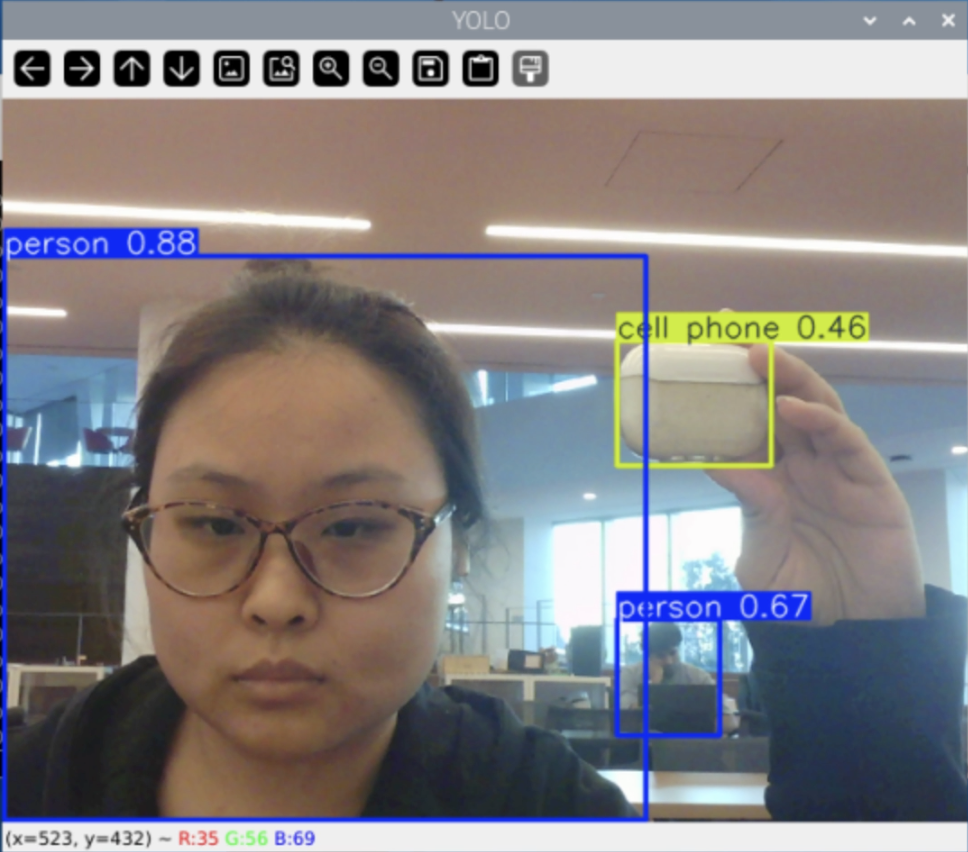

# Observant Systems: Overnight Sensation

**Members:** Wenqing Pan(wp273, Github: WenqingPan-Lucy ); Mandy Mao(mm3599, Github:manrongm)


<details>
	<summary><strong>Instructions for Students (Click to Expand)</strong></summary>
  
	**Submission Cleanup Reminder:**
	- This README.md contains extra instructional text for guidance.
	- Before submitting, remove all instructional text and example prompts from this file.
	- You may delete these sections or use the toggle/hide feature in VS Code to collapse them for a cleaner look.
	- Your final submission should be neat, focused on your own work, and easy to read for grading.
  
	This helps ensure your README.md is clear, professional, and uniquely yours!
</details>


---

# Part 1

## Part A. 

We successfully installed YOLO26 and exported the nano model to NCNN format for running on the Raspberry Pi. We first tested object detection using the sample bus image.


We then tested YOLO object detection on another image to observe how the model identifies objects in different scenes.


\*\*\***Include a screenshot of `ollama list` showing your models.**\*\*\*

We installed Ollama and downloaded the two Qwen models required for this lab:

- `qwen3.5:0.8b`
- `qwen3:0.6b`

The screenshot below shows the installed models using the `ollama list` command.


## Part B. 


\*\*\***Include a short video or screenshots of your experiments with the person detection. Write down three situations where it did not see you, or saw a person who was not there, and what you think the cause was.**\*\*\*


I tested YOLO with my webcam using different commands and confidence thresholds. I also changed my position, showed different objects to the camera, and tested how the model performed under partial visibility, different distances, and low-light conditions.

### 1. Default Detection

**Command:**

python yolo_person.py


**Actual Result:**

YOLO successfully detected people in real time and drew bounding boxes around them. The confidence scores changed as I moved or changed my position.

Interestingly, when I showed only one of my arms to the camera while keeping the rest of my body outside the frame, YOLO still detected it as a person.

I also showed a photo of a person on my phone, and YOLO identified the person in the photo.

**Explanation:**

YOLO does not always need to see a complete human body to detect a person. It can sometimes recognize a person based on limited visual features, such as a visible arm. This can be useful when someone is partially blocked or outside the camera's view.

However, the model cannot reliably distinguish a real person from a person displayed on a screen.

### 2. Lower Confidence Threshold (--conf 0.2)

**Video:** [Low Confidence Detection](https://drive.google.com/file/d/1ZU4gx6UtopPDo3UMGfKiFwzsQH9XiFPY/view?usp=sharing)

**Command:**

python yolo_person.py --conf 0.2


**Actual Result:**

When I lowered the confidence threshold to 0.2, YOLO detected more objects as people. It incorrectly identified my backpack as a person with a confidence score of 0.44.

**Explanation:**

A lower confidence threshold allows more uncertain predictions to appear. This can help detect people that the model is less confident about, but it also increases the chance of false positives.

In this case, the model probably confused some visual features of my backpack with those of a person.

### 3. Higher Confidence Threshold (--conf 0.7)

**Video:** [High Confidence Detection](https://drive.google.com/file/d/1AIAn09E9ksBDBHLNOCIpnf0wlVr2hLmT/view?usp=sharing)

**Command:**

python yolo_person.py --conf 0.7


**Actual Result:**

When I increased the confidence threshold to 0.7, YOLO no longer detected my backpack as a person. The model only displayed detections with higher confidence scores.

I also tested the camera by pointing it toward people outside a glass window. When the people were farther away, YOLO failed to detect them as people.

**Explanation:**

The higher threshold filtered out the incorrect backpack detection because its confidence score was only 0.44.

However, the higher threshold also increased the risk of missing real people. In the window experiment, the people appeared smaller in the camera frame, and the glass may have affected image clarity. These factors could have reduced the detection confidence below 0.7.

This experiment shows the trade-off between reducing false positives and avoiding false negatives.

### 4. Detect All Objects (--all)

**Video:** [All Objects Detection](https://drive.google.com/file/d/1MkgUY2JSLbdKVTSeWhyiDp5hIs3KrosI/view?usp=sharing)

**Command:**

python yolo_person.py --all


**Actual Result:**

YOLO correctly identified some objects, including a chair and a cell phone. However, it also incorrectly identified my headphones as a cell phone with a confidence score of 0.46.

I noticed that objects farther away from the camera usually had confidence scores below 0.5.

The detection was not always stable. For example, a chair in the background sometimes appeared and disappeared between frames, even though it was not moving.

**Explanation:**

The `--all` flag allows YOLO to detect all 80 COCO object classes instead of only people.

However, the model can still confuse objects with similar visual features. Headphones are not a separate category in the standard COCO dataset, which may have contributed to the incorrect classification.

Distant objects are also more difficult to recognize because they appear smaller and have fewer visible details.

Small changes between frames can affect confidence scores. If the confidence drops below the threshold, the bounding box disappears even though the object remains in the scene.

### 5. Headless Mode (--headless)

**Command:**

python yolo_person.py --headless

**Actual Result:**

The program ran without opening a camera window. Instead, it continuously printed detection results in the terminal, including the position, height, and confidence score of each detected person.

**Explanation:**

The `--headless` flag allows YOLO to run without a graphical interface.

This is useful when running the program through SSH or when the Raspberry Pi needs to monitor the environment overnight without displaying the camera feed.

### 6. Detection in a Dark Room

**Command:**

python yolo_person.py --headless


**Actual Result:**

I tested YOLO in a dark room with all the lights turned off.

Surprisingly, YOLO was still able to detect a real person in all of my tests. It successfully identified the person when facing the camera, turning their back, and even when only part of their body was visible.

However, the results were different when I showed a picture of a person on my phone.

When I held the phone very close to the camera, YOLO could detect the person in the picture. But when I moved the phone farther away, it could no longer detect the person.

**Explanation:**

I think detection depends on how much visual information the camera can capture. Even though the room was dark, the camera still seemed to capture enough information to recognize a real person.

For the picture on my phone, the person became smaller in the camera frame as I moved the phone farther away. This may have made it harder for YOLO to recognize human features. The screen brightness and surrounding lighting conditions might also have affected the results.

This experiment suggests that YOLO can still work under some low-light conditions, but detection performance depends on distance, visibility, and the available visual information.

**Possible Application:**

Headless mode would be useful for an overnight observant system because the Raspberry Pi can monitor the environment without displaying a camera window.

However, I would need to consider lighting conditions and detection errors before relying on the results.

---

### Detection Errors and Limitations

#### Error 1: Backpack Detected as a Person


When I used `--conf 0.2`, YOLO incorrectly detected my backpack as a person with a confidence score of 0.44.

When I increased the threshold to 0.7, this false detection disappeared.

**Possible Cause:**

The model may have confused the backpack's shape with human features. The lower confidence threshold allowed this uncertain prediction to appear.

Increasing the threshold removed the false positive, but it did not change the model's underlying classification ability.

#### Error 2: Person in a Phone Photo Detected as a Real Person


I showed a picture of a person on my phone, and YOLO identified the person in the picture.

**Possible Cause:**

YOLO recognizes visual features associated with people, but it does not determine whether the detected person is physically present in the environment or displayed on a screen.

Although detecting a person in a photograph is not necessarily incorrect for an object detection model, it could become a false alarm in a room-monitoring system.

#### Error 3: Distant People Not Detected 


When I used `--conf 0.7` and pointed the camera toward people outside a glass window, YOLO failed to recognize them as people.

**Possible Cause:**

The people were relatively far from the camera and appeared smaller in the image. This reduced the amount of visual detail available for detection.

The glass window may also have affected image clarity through reflections or reduced contrast.

Combined with the high confidence threshold of 0.7, these factors may have caused the detections to be filtered out.

This shows that a high confidence threshold can cause the system to miss real people, especially when they are far away.

#### Error 4: Headphones Detected as a Cell Phone (Misclassification)



When I used `--all`, YOLO incorrectly identified my headphones as a cell phone with a confidence score of 0.46.

**Possible Cause:**

The model may have confused their visual features. Headphones are not a separate class in the standard COCO dataset, so the model may have matched them to a category it already recognized.

#### Additional Limitation: Unstable Detection of Distant Objects

I noticed that distant objects usually had lower confidence scores, often below 0.5.

For example, a chair in the background was sometimes detected, but its bounding box disappeared in the next frame even though the chair had not moved.

**Possible Cause:**

Distant objects appear smaller in the image, providing less visual information for the model.

Small changes in camera frames or confidence scores may cause detections to appear and disappear, even when the environment remains unchanged.

### Conclusion

Through these experiments, I learned that YOLO can detect people even when only part of their body is visible, but it can also make mistakes when objects have similar visual features.

I also observed that confidence thresholds significantly affect detection results. A lower threshold allows more detections but increases the risk of false positives, while a higher threshold filters out uncertain predictions but may miss real people.

Distance and visibility also influence detection performance. Objects farther from the camera were generally harder to detect consistently.

For an overnight observant system, I think it would be better to evaluate detections across multiple frames rather than treating every individual prediction as a real event. This could help reduce false alarms and make the system more reliable.


## Part C. 

\*\*\***Include a screenshot or short video of the hand pose demo, and write how you might use face, hand or body pose tracking in your observant system.**\*\*\*


I tested the MediaPipe hand tracking system using my webcam. I tried different hand gestures, distances, movements, and partial occlusion to see how well the system works.

### 1. Pinch Gesture — Volume Control

**Actual Result:**

The volume changed when I moved my thumb and index finger closer together or farther apart. The system responded to the changes pretty smoothly, and I did not notice any obvious delay or jumping when I moved my hand quickly.

However, I noticed that the distance between my hand and the camera also affected the volume. When I moved my hand farther away, the volume became lower, even though I kept exactly the same hand gesture.

### 2. Quiet Coyote Gesture — Mute Control

**Actual Result:**

The Quiet Coyote gesture worked well when my hand was close to the camera. The system could recognize the gesture and mute the audio immediately.

However, when I moved my hand farther away, around 30 cm or more, the system could not mute the audio immediately anymore. Sometimes it did not recognize the gesture correctly.

### 3. Detection Errors and Limitations

**Limitation 1: Distance Affects Volume Control**

When I kept the same pinch gesture but moved my hand farther away from the camera, the volume decreased.

I think this happened because the program calculates the distance between finger landmarks in the image, instead of measuring the actual physical distance between my fingers. This makes the volume depend on both my gesture and how far my hand is from the camera.

One possible improvement would be to normalize the distance between the thumb and index finger by the overall size of the hand in the image, rather than using the raw pixel distance.

**Limitation 2: Partial Occlusion Affects Pinch Detection**

When I covered the last three fingers, the volume control did not work correctly anymore, even though my thumb and index finger were still visible.

I think this happened because MediaPipe needs enough visible hand features to estimate the hand landmarks correctly. When some fingers were hidden, the model may have difficulty estimating the full hand position.

**Limitation 3: Quiet Coyote Is Sensitive to Occlusion**

I noticed that the Quiet Coyote gesture was even more sensitive to occlusion. When I covered even a small part of my fingers, the system could no longer recognize the gesture.

This may happen because the program needs to check the positions of several fingers at the same time. If one of the important landmarks is blocked or estimated incorrectly, the gesture may not match the predefined rules.

**Limitation 4: Recognition Becomes Less Reliable at Longer Distances**

When my hand was around 30 cm or farther from the camera, the Quiet Coyote gesture became less responsive.

I think this is because the hand takes up fewer pixels in the image, making the finger landmarks harder to estimate accurately.

### 4. Possible Application in My Observant System

I could use hand gestures to control an overnight monitoring device. For example, I could use a specific hand gesture to start the system before going to bed, instead of pressing a button or typing a command.

When I wake up, I could use another gesture to stop monitoring and ask the device to show a summary of what happened overnight.

However, based on my tests, I think the camera should be placed close enough to the user, and the gestures should be simple. I would also avoid gestures that require very precise finger positions because they may not work well when the hand is far away or partially blocked.

To make the interaction more reliable, the system could require a gesture to be detected consistently for a few consecutive frames before triggering an action. This could help prevent accidental activation or deactivation caused by temporary detection errors.

### 5. Demo

**Video:** [MediaPipe Hand Pose Demo](https://drive.google.com/file/d/1P7_zJDgPw1eoyUCjfTD4EgkEx6yU9rpw/view?usp=sharing)


## Part D. 

\*\*\***Ask Qwen three questions to answer. Paste the questions, the answers and how long each took. Try one of them with `qwen3:0.6b` and compare.**\*\*\*

I tested two Qwen models locally on my Raspberry Pi using Ollama. I first asked them about Roosevelt Island, and then tested three questions that a bedside device might need to answer.

### 1. Roosevelt Island History Test

**Qwen3.5:0.8b Response:**

> Roosevelt Island was originally built by immigrants from New York to escape the harsh winters and poor conditions of Manhattan, with its first concrete structure appearing in 1895. The island has remained largely unchanged since then, serving as a quiet refuge for families seeking peace while preserving its historic architecture and waterfront views.

**Response Time:** 92.1 seconds

**Qwen3:0.6b Response:**

> Roosevelt Island is a small island in the Pacific Ocean, located in the state of New Jersey, USA. It was established in 1907 as a temporary refuge for the United States Navy during World War I. The island was initially used as a military base and later became a significant cultural and historical site. Today, it is a peaceful retreat for the community, preserving its natural beauty and historical significance.

**Response Time:** 57.7 seconds

**Observation:**

Both models gave incorrect historical information. Qwen3.5 invented a story about immigrants building the island, while Qwen3 even placed Roosevelt Island in the Pacific Ocean and New Jersey. The smaller model was faster in this test, but neither answer was accurate.

### 2. Bedside Device Questions

**Question 1: What should I do if I cannot fall asleep? Give me three simple suggestions.**

**Model:** Qwen3.5:0.8b

**Answer:**

> 1. Try to relax your muscles and take a deep breath to calm your mind.
> 2. Listen to soothing music or read a quiet book to distract yourself from the noise.
> 3. Drink a glass of warm water to help clear your head and improve sleep quality.

**Response Time:** 60.2 seconds

**Observation:**

The model gave three simple suggestions, and most of them seemed reasonable. However, the response took about a minute, which may be too slow for a device that needs to respond immediately.

**Question 2: A person entered the room at 11 PM and left at 11:15 PM. What happened? Answer in one sentence.**

**Model:** Qwen3.5:0.8b

**Answer:**

> The person likely slept, as they stayed awake only for a brief moment during their sleep cycle.

**Response Time:** 32.0 seconds

**Observation:**

This answer was incorrect. I only told the model that someone entered and left the room, but it assumed the person was sleeping. This shows that Qwen can make up events that are not included in the input data.

**Question 3: My camera did not detect anyone between midnight and 6 AM. Does that prove nobody entered the room?**

**Model:** Qwen3.5:0.8b

**Answer:**

> No, this does not prove nobody entered the room; it simply means no one was detected during that specific time window.

**Response Time:** 29.5 seconds

**Observation:**

The model answered correctly. It understood that no detection does not necessarily mean nobody entered the room. This is important because the camera or object detection model could miss someone.

### 3. Model Comparison

I tested Question 3 again using the smaller `qwen3:0.6b` model.

**Qwen3:0.6b Answer:**

> The device detected no movement between midnight and 6 AM, which could indicate an absence of people, but it's not certain. The camera's performance may vary, and other factors like lighting or movement patterns could also play a role.

**Response Time:** 44.1 seconds

**Comparison:**

Both models understood that the absence of detection does not prove that nobody entered the room. The smaller model gave a longer answer and mentioned possible issues like lighting and camera performance. However, it also described the input as "no movement," even though the question only said no people were detected.

Qwen3.5 took 29.5 seconds, while Qwen3 took 44.1 seconds. So even though Qwen3 is smaller, it was actually slower in this test.

### 4. Image Understanding Test

**Question:** What is in this photo?

**Qwen3.5:0.8b Answer:**

> A young woman wearing glasses and a dark shirt is taking a selfie in an office setting with bright fluorescent lighting.

**Response Time:** 123.8 seconds

**Observation:**

The model was able to generate a description of the image, but it took more than two minutes. I did not independently verify every detail of the description. The long response time shows that image understanding can be expensive for a small model running locally on the Pi.

### 5. What I Learned

I found that both Qwen models could answer simple questions, but they sometimes generated information that was not supported by the input. The Roosevelt Island test and the room entry question showed this problem clearly.

I also noticed that the models were quite slow on the Raspberry Pi, especially when processing an image. For my overnight observant system, I think it would be better to let the device collect data during the night and ask Qwen to summarize it in the morning, instead of expecting an immediate response.

I would also give the model specific detection logs and ask it to only use the information provided, so it does not make up events that never happened.


## Part E. 

In this part, I connected YOLO with Qwen to build an observant system. YOLO detected people and objects through the webcam, the interpreter converted the detections into text, and Qwen used the saved logs to answer questions.

I tested the pipeline four times with different questions and settings. I also modified the `interpret()` function to make the logs more clear.

### Run 1: Original Pipeline — Person Detection

**Command:**

```bash
python yolo_to_qwen.py
```

**Log:**

```text
20:13:39 nobody
20:13:50 1 person(s) at right/close
20:13:51 1 person(s) at center/close
20:14:01 1 person(s) at center/far
20:14:21 1 person(s) at right/far
20:14:26 1 person(s) at center/far
20:14:27 1 person(s) at left/far
```

**Question:**

How many people were there, what were they doing, and did anything change?

**Qwen Answer:**

> There was only one person present throughout the entire 60-second observation period. They were standing near a center/close position for the majority of the time, but their location shifted to right/far and then left/far at specific intervals. No significant change in activity occurred; the camera simply recorded the sequential movements of that single individual.

**Response Time:** 32.5 seconds

**Accuracy: Partially Correct**

Qwen correctly noticed that the detected person's position changed. However, it said one person was present during the entire observation, even though the first log entry was `nobody`. It also said the person was standing most of the time, but the log did not record whether the person was standing or sitting.

I think Qwen made some assumptions based on the positions instead of only using the information in the log.

### Run 2: Asking a Different Question

**Command:**

```bash
python yolo_to_qwen.py --log watch_log_run1.txt --question "Did anyone leave the room?"
```

For this test, I reused the log from Run 1 but changed the question.

**Log:**

Same as Run 1 (`watch_log_run2.txt`).

**Question:**

Did anyone leave the room?

**Qwen Answer:**

> No one is explicitly stated to be leaving the room; however, the presence of multiple people at various distances (center, right, left, and far) throughout the 60-second interval indicates that activity occurred within the space. The absence of a "nobody" line suggests no one was absent from the room during this period.

**Response Time:** 13.2 seconds

**Accuracy: Partially Correct**

Qwen correctly said the log did not explicitly show anyone leaving the room. However, it made two mistakes.

First, it said there were multiple people, but the log only showed one person in each detection. Second, it said there was no `nobody` entry, even though the first line clearly showed `nobody`.

This showed me that changing the question can lead to different conclusions, even when the input log is exactly the same.

### Interpreter Modification

After Runs 1 and 2, I modified the `interpret()` function because Qwen sometimes misunderstood the original log format.

**Original Output:**

```text
nobody
1 person(s) at center/close
```

**Modified Output:**

```text
No person detected in the current camera frame.
Current frame: 1 person detected at center/close.
```

I also changed the output format when multiple people are detected, so the log describes the number of people in the current frame more clearly.

**Why I Changed It:**

I wanted the log to describe what the camera actually detected, instead of making statements about the whole room. For example, `nobody` could be interpreted as nobody being in the room, while `No person detected in the current camera frame` is more specific.

I also wanted to make it clear that each line represents a detection at a particular time, not the identity or movement history of a person.

I kept the original position and distance rules, so the main change was how the interpreter described the results.

### Run 3: Testing the Modified Interpreter

**Command:**

```bash
python yolo_to_qwen.py --headless --seconds 60 --question "How many people were detected, and did anyone leave the camera view?"
```

**Log:**

```text
20:38:07 No person detected in the current camera frame.
20:38:14 Current frame: 1 person detected at right/far.
20:38:15 Current frame: 1 person detected at center/far.
20:38:20 Current frame: 1 person detected at center/close.
20:38:31 Current frame: 1 person detected at left/close.
20:38:36 Current frame: 1 person detected at left/far.
20:38:40 Current frame: 1 person detected at center/far.
20:38:44 Current frame: 1 person detected at right/far.
20:38:59 Current frame: 1 person detected at right/close.
20:39:00 Current frame: 1 person detected at center/close.
```

**Question:**

How many people were detected, and did anyone leave the camera view?

**Qwen Answer:**

> The detector recorded a total of 1 person across all six frames, indicating that no one left the room; however, the log explicitly states "No person detected" at the very beginning of the recording. Therefore, while the count remains constant, the initial reading was for an empty frame.

**Response Time:** 19.4 seconds

**Accuracy: Partially Correct**

This time, Qwen correctly noticed that the first entry showed no person detected. It also recognized that the later entries each showed one person.

However, it said there were only six frames, even though the log contained ten entries. Also, the log only records changes in detection results, not every camera frame.

Qwen also concluded that nobody left the room, but the camera data cannot really prove that. It only shows whether a person was detected in the camera view.

The modified interpreter made the log more specific, but Qwen still made some incorrect assumptions.

### Run 4: Detecting All Objects

**Command:**

```bash
python yolo_to_qwen.py --headless --seconds 30 --all --question "What objects were detected, and did their positions change?"
```

**Log:**

```text
20:43:06 Current frame: 1 person detected at center/far.
20:43:11 Current frame: 1 person detected at center/far. Other detected objects: cell phone
20:43:18 Current frame: 1 person detected at center/far.
20:43:20 Current frame: 1 person detected at center/far. Other detected objects: bottle
20:43:24 Current frame: 1 person detected at center/far.
20:43:29 Current frame: 1 person detected at center/far. Other detected objects: cell phone
20:43:34 Current frame: 1 person detected at center/far.
```

**Question:**

What objects were detected, and did their positions change?

**Qwen Answer:**

> The camera detected a single person at the center of the frame throughout the 30-second period. No other objects were identified in the log. Consequently, no positions changed for any detected object.

**Response Time:** 8.5 seconds

**Accuracy: Partially Correct**

Qwen correctly identified that the person stayed at `center/far` in the recorded readings. However, it completely missed the other detected objects.

The log clearly showed `cell phone` twice and `bottle` once, but Qwen said no other objects were identified.

Also, the interpreter only recorded the names of other objects, not their positions. So Qwen did not have enough information to determine whether the phone or bottle moved.

This test showed two different problems. Qwen sometimes ignores information that is already in the log, and the interpreter also limits what information Qwen can use.

### What I Learned

From these experiments, I found that connecting YOLO with Qwen allows the Raspberry Pi to detect changes in the environment and generate summaries from the logs. However, the answers were not always accurate.

Sometimes Qwen missed information that was clearly recorded, and sometimes it made assumptions that the camera data did not support.

I also learned that the interpreter is important because it decides what information gets passed to Qwen. After I changed the descriptions to focus on the current camera frame, the logs became more specific. However, this did not completely prevent incorrect answers.

For my overnight observant system, I think the device should record clear observations and avoid treating Qwen's interpretation as a confirmed fact.

---

# Lab 5 Part 2: Overnight Sensation

For Part 2, you will use the observant system from Part 1 to design a night-time interaction. On-device AI is slow, so let it work while you sleep. The person meets the device twice: **before bed**, when they hand the night over, and **when awake**, when the device gives something back. In between, the pipeline from Part E runs on its own.

Two flavors, pick one or mix them:

* **Sense all night.** The Pi watches, listens or measures from bedtime until morning and keeps a log.
* **Process all night.** You already have the data (a day of phone photos, a long recording) and the Pi needs hours to get through it.

Two house rules. Sample rather than stream: one look every 5 to 30 seconds is plenty, and it keeps the Pi cool. And keep everything on the Pi: tell the people you live with, point the camera at things rather than at beds, and delete the snapshots after the demo.

## Part F. 
### Read Part 2 and storyboard your night-time interaction

Storyboard a night-time interaction built on your observant system, in three panels:

1. **Before bed.** How does the person hand the night over, and how does the device acknowledge it?
2. **While asleep.** What does the device watch or work through?
3. **When awake.** What is the one thing the person learns, and in what medium?

Stuck? A kitchen that tells you who raided the fridge. A desk that reports whether you actually went to bed. A window that names the quietest hour. A plant that describes its night. Find something better.

Use storyboards and/or [Verplank diagrams](https://ccrma.stanford.edu/courses/250a-fall-2004/IDSketchbok.pdf).

\*\*\***Insert ideas, sketches, Verplank diagrams and storyboards for your night-time interaction here.**\*\*\*

## Prep for Part 2

1. Look at and give feedback on the Part F storyboards.
   **Put the feedback for your ideas here.**
2. [Update your Lab Hub](prep.md#get-the-latest-content) to get the latest content for Part 2.
3. Decide where the device will spend the night and who else lives there. Get their OK before the first run.
4. Revise your storyboard with the feedback and with what you learned in Part E about where the pipeline breaks.

\*\*\***Post your revised storyboard here.**\*\*\*

## Part G. 
### Design the interaction before

The hand-off: the person tells the device what to watch tonight, and the device acknowledges it. Keep it to a thirty-second ritual. A button or a touch (Lab 4), a spoken sentence (Lab 3), a wave or a Quiet Coyote at the camera (Part C). The acknowledgement can be a line on the display, a tone, or an LED that dims rather than lights up. At its simplest, the hand-off just sets the question that the morning will answer.

\*\*\***Describe the interaction before.**\*\*\*

## Part H. 
### Incorporate the observant system

The Part E pipeline becomes the night shift. `overnight.py` runs your `interpret()` from `yolo_to_qwen.py` every few seconds, people only unless you pass `--all`, and writes the readings to `night_log.jsonl`; the reasoning waits for the morning. Start it inside `tmux` so it keeps running after you close your laptop, and stop it with Ctrl-C in the morning:

```
(.venv) pi@raspberrypi:~/Interactive-Lab-Hub/Lab 5 $ tmux new -s night
(.venv) pi@raspberrypi:~/Interactive-Lab-Hub/Lab 5 $ python overnight.py
```

Fake a night first: run it for thirty seconds while you walk around, stop it, and run `morning.py` from Part I. When that looks right, run a real night. If your storyboard needs a sensor rather than the camera, swap in the Lab 4 example code and log its reading the same way.

\*\*\***Screenshots or videos of the running system.**\*\*\*

## Part I. 
### Design the interaction after

The reveal. The night produced a log; the morning turns it into something a half-awake person can take in. `morning.py` is the smallest version: it asks Qwen for a three-sentence report.

```
(.venv) pi@raspberrypi:~/Interactive-Lab-Hub/Lab 5 $ python morning.py
```

Make it yours: show the report on the Mini PiTFT, read it aloud with Piper from Lab 3, plot the night as a timeline, or ask for JSON (`--json`, Part D) and move a servo. Whatever you pick, make sure it is honest about a night in which nothing happened.

## Final documentation

Document all the prototypes and iterations you have designed and worked on. The deliverables for this lab are writings, sketches, photos, and videos that show what your system:

* "Looks like": how the device sits in the room at night, and what it looks like at bedtime and in the morning.
* "Works like": the pipeline from detector to interpreter to log to reasoner, with a real night's data.
* "Acts like": how a person hands the night over and what they get back.

\*\*\***Include a short video of the whole system**\*\*\*

As always, make sure you document contributions and ideas from others (and AI) explicitly in your writeup.

You are permitted (but not required) to work in groups and share a turn in; you are expected to make equal contribution on any group work you do, and N people's group project should look like N times the work of a single person's lab. Make sure the page for the group turn in is linked to your personal Interactive Lab Hub page.

## Deliverables & Submission for Lab 5

For submission, the readme.md page for this lab should be edited to include the work you have done:
* Upload any materials that explain what you did, including your code and night log, into your Lab 5 repository, and link them in your Lab 5 readme.md.
* Labs are due on Sundays, make sure to submit your Lab 5 readme.md to Canvas.

<details>
  <summary><strong>Submission Cleanup Reminder (Click to Expand)</strong></summary>

  **Before submitting your README.md:**
  - This readme.md file has a lot of extra text for guidance.
  - Remove all instructional text and example prompts from this file.
  - You may either delete these sections or use the toggle/hide feature in VS Code to collapse them for a cleaner look.
  - Your final submission should be neat, focused on your own work, and easy to read for grading.
</details>
